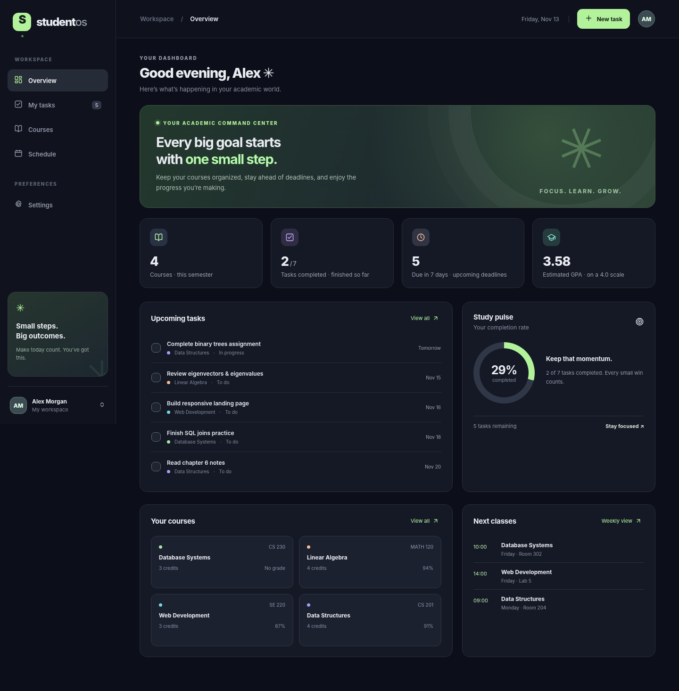
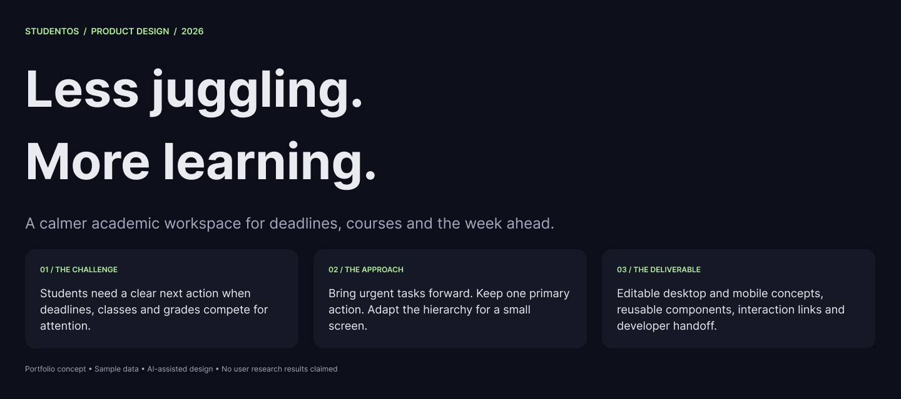
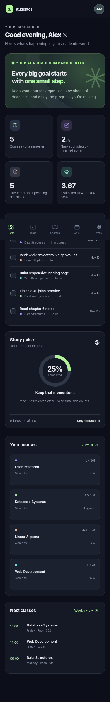

<div align="center">

# ✳ StudentOS

### Your academic command center.

A thoughtfully designed, full-stack student workspace for courses, assignments, weekly schedules and academic progress.

**FastAPI · Python · SQLite · JavaScript · HTML · CSS**

### [Launch the live demo](https://studentos-demo.onrender.com) · [View source on GitHub](https://github.com/taubainurkanat-wq/studentos)

[Figma design](#figma-design-case-study) · [Features](#features) · [Quick start](#quick-start) · [Live demo deployment](#live-demo-deployment) · [API](#api) · [Roadmap](#roadmap)

</div>



## Figma design case study

[**Open the editable Figma design**](https://www.figma.com/design/sY2vgCp8rcxx8bRYpWtEuJ) · [**Read the UI/UX case study**](docs/design/README.md)

Seven editable boards explore the desktop overview, task management, creation form, mobile layout, recovery states and reusable components. The case study includes exported previews, design decisions and developer handoff. This is a design proposal; the running application retains its current interface.



## Overview

StudentOS is a responsive academic productivity application, not just a static landing page. It combines a custom dark-mode interface with a Python REST API and SQLite persistence. Every signed-in user has their own courses, tasks, class schedule and grades.

## Features

- **Dashboard:** personalized overview, upcoming deadlines, progress ring, course summaries and next classes.
- **Task manager:** create, edit, complete, search, filter and delete tasks; track priority, status and deadlines.
- **Courses and grades:** manage courses, instructors, credits and current overall grades.
- **Estimated GPA:** credit-weighted calculation on a sample 4.0 grading scale. Not an official university GPA.
- **Weekly timetable:** add lectures, labs and seminars to a seven-day schedule.
- **Accounts:** register, sign in, sign out and edit your profile.
- **Try demo:** load an independent workspace with example courses and assignments instantly.
- **Responsive UI:** optimized layouts for laptops, tablets and phones.
- **API docs:** interactive OpenAPI documentation served automatically by FastAPI.

<details>
<summary>Mobile preview</summary>



</details>

## Quick start

You need **Python 3.11+**. No Node.js, npm or JavaScript build tools are required.

### Windows (easiest)

1. Download or clone this repository.
2. Open the project folder.
3. Double-click **`start.bat`**.
4. Wait for the terminal to show the server address.
5. Visit **http://127.0.0.1:8000** in your browser.
6. Click **Explore demo workspace**, or register an account.

On the first run, the script creates `.venv` and installs Python packages. Keep the terminal window open while using StudentOS.

### Terminal / macOS / Linux

```bash
git clone https://github.com/taubainurkanat-wq/studentos.git
cd studentos
python3 -m venv .venv
source .venv/bin/activate
python -m pip install -r requirements.txt
python -m uvicorn app:app --reload
```

> The clone link will work once this project has been published to that repository.

### Windows PowerShell (manual alternative)

```powershell
py -m venv .venv
.venv\Scripts\python.exe -m pip install -r requirements.txt
.venv\Scripts\python.exe -m uvicorn app:app --reload
```

## Live demo deployment

**Live demo:** [https://studentos-demo.onrender.com](https://studentos-demo.onrender.com)

This repository contains a Render Blueprint: [`render.yaml`](render.yaml).

1. Sign in to [Render](https://dashboard.render.com/) and connect your GitHub account.
2. Choose **New → Blueprint** and select `taubainurkanat-wq/studentos`.
3. Review the Blueprint; it specifies a **Free** Python Web Service named `studentos-demo`.
4. Open the deployed app at **[studentos-demo.onrender.com](https://studentos-demo.onrender.com)**.
5. Select **Launch interactive demo** to try the application without creating an account.

The Blueprint uses `STUDENTOS_PUBLIC_DEMO=1`, which disables real user registration and sign-in, but creates isolated, temporary demo workspaces for visitors. The local version still supports registration and login. **The free Render filesystem is ephemeral**: sample tasks/grades may disappear after idle shutdown, restart, or redeployment. Do not enter real passwords, grades, or confidential information. Use durable storage and security controls before offering real accounts to the public.

## Project structure

```text
StudentOS/
├── app.py                # FastAPI routes, authentication, SQLite database
├── frontend/
│   ├── index.html        # App shell, authentication screen
│   ├── styles.css        # Custom responsive UI
│   ├── app.js            # State management, API calls, forms and views
│   └── favicon.svg
├── tests/
│   └── test_app.py       # API tests: auth, CRUD, access control, validation
├── docs/
│   ├── desktop.png
│   └── mobile.png
├── .github/workflows/     # Automated GitHub Actions tests
├── requirements.txt
├── render.yaml             # Public Render demo deployment
├── start.bat              # One-click Windows launcher
├── start.sh               # macOS/Linux launcher
└── README.md
```

The app stores data in **`studentos.db`**, created automatically on first launch. The database file and virtual environment are excluded from version control.

## API

Run the server and open **http://127.0.0.1:8000/api/docs** to explore every route.

| Area | Endpoints |
|---|---|
| Authentication | `POST /api/auth/register`, `/login`, `/logout`, `/demo` |
| Profile | `GET /api/me`, `PATCH /api/me` |
| Application state | `GET /api/state` |
| Courses | `POST /api/courses`, `PATCH /api/courses/{id}`, `DELETE /api/courses/{id}` |
| Tasks | `POST /api/tasks`, `PATCH /api/tasks/{id}`, `DELETE /api/tasks/{id}` |
| Timetable | `POST /api/schedule`, `PATCH /api/schedule/{id}`, `DELETE /api/schedule/{id}` |

All private operations require an `Authorization: Bearer <token>` header. Data is scoped to the signed-in user's account.

## GPA estimate

StudentOS converts a course's entered overall percentage to grade points and calculates a credit-weighted average:

`GPA = Σ(grade_points × credits) / Σ(graded_course_credits)`

The built-in sample scale is: 95–100 → 4.00, 90–94 → 3.67, 85–89 → 3.33, 80–84 → 3.00, 75–79 → 2.67, 70–74 → 2.33, 65–69 → 2.00, 60–64 → 1.67, 55–59 → 1.33, 50–54 → 1.00, below 50 → 0.00. Courses without a grade are not included.

**Disclaimer:** grading policies vary between institutions. This feature is only a planning estimate and should not replace the university's official transcript or GPA calculation.

## Tests

```bash
python -m pip install -r requirements.txt pytest httpx
python -m pytest -q
```

The automated tests cover registration/login/logout, separate account ownership, CRUD for courses/tasks/schedule, input validation, demo data, and static file serving. GitHub Actions runs the same suite on every push and pull request.

## Security and privacy

StudentOS is a portfolio **MVP**, designed to run locally. Passwords use salted PBKDF2-HMAC-SHA256 hashes; random session tokens are stored as SHA-256 hashes and expire in seven days; SQL queries use bound parameters; and users cannot edit other users' records.

**Before exposing this application on the public internet**, add HTTPS, rate limiting for authentication/demo endpoints, account recovery, session management controls, logging/monitoring, production deployment configuration and a stronger operational database strategy. Do not use a real university password. The demo creates disposable sample accounts; use registration if you want a reusable account.

## Roadmap

- [x] Dark responsive UI
- [x] User registration and login
- [x] Persistent SQLite database
- [x] Course and task CRUD
- [x] GPA estimate
- [x] Weekly timetable
- [x] API tests and GitHub Actions CI
- [ ] Add weighted assignments and configurable university grade scales
- [ ] Calendar sync and notifications
- [x] Render Blueprint for a disposable public demo
- [ ] Verify public HTTPS deployment URL on Render
- [ ] Accessibility and end-to-end browser tests in CI

---

Made as a full-stack software engineering portfolio project. Built to be understandable, extensible, and genuinely useful.
