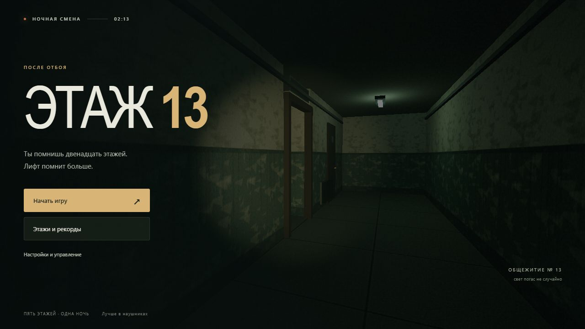
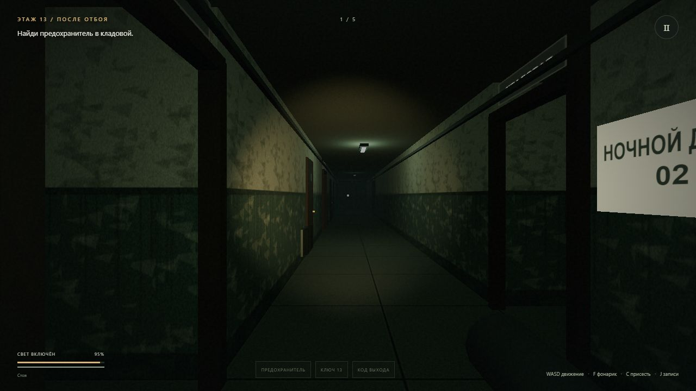

# Floor 13 · After Hours

A first-person horror game for desktop and iPhone browsers. Escape five connected floors by exploring rooms, solving puzzles and staying out of sight of a creature that reacts to light and running.

**[Play the game](https://floor13-after-hours.onrender.com)** · **[Инструкция на русском](README_RU.md)**



## Gameplay

- Five floor layouts with alternate passages, locked rooms and different objectives.
- An enemy with line-of-sight detection, sound awareness, patrol routes and pursuit memory.
- Flashlight charge, stamina, crouching and a safe room on each floor.
- Archive fragments, ordered valves, a radio-frequency puzzle and a timed final escape.
- Checkpoints, chapter selection, collectible tapes and local personal records.
- A daily challenge with different item positions and access codes after completing the campaign.
- Floating touch joystick, independent camera gestures and adjustable button sizes.
- Story, normal and hard modes. Story mode disables pursuit and the final countdown.



## Campaign

| Floor | Chapter | Objective |
|---|---|---|
| 13 | After Hours | Restore power, find a key and discover the staircase code |
| 12 | Archive of Voices | Collect three archive cards and unlock a terminal |
| 11 | Under Pressure | Read the instructions and close valves in order |
| 10 | Dead Frequency | Power a radio, tune its frequency and retrieve a transcript |
| −1 | Last Shift | Find three power modules and escape before the generator stops |

The game interface and story are in Russian.

## Run locally

Requires **Node.js 20+**. The project uses local assets and has no package-install step.

```sh
node server.mjs
```

Open **http://localhost:8080**. Windows users can also run `START_WINDOWS.bat`. ES modules require an HTTP server, so launch through the server instead of opening the HTML file directly.

## Controls

| Action | Desktop | Touch |
|---|---|---|
| Move | WASD / up and down arrows | Touch and drag on the left |
| Look | Mouse, drag, or left and right arrows | Drag on the right |
| Interact | E | Action button or a short tap on the right |
| Flashlight | F | Light button |
| Crouch | C | Quiet button |
| Run | Hold Shift | Full forward joystick tilt or run toggle |
| Journal and map | J | Map button at the top |
| Pause | Esc | Pause button |

On iPhone, open the game in Safari. Use Share → Add to Home Screen to launch it as a standalone web app. The service worker caches game assets after the first successful load. Saved progress and records belong to the current browser and domain, and browser storage can be cleared by the operating system.

To preview the touch layout on a desktop, open `http://localhost:8080/?controls=touch`.

## Implementation

| Module | Responsibility |
|---|---|
| `dist/world.js` | Three.js scene, procedural textures, lights, props and creature model |
| `dist/game.js` | Gameplay loop, UI, interactions, pursuit and checkpoints |
| `dist/campaign.js` | Floor objectives, prerequisites, codes and transitions |
| `dist/core.js` | Grid collision, visibility, breadth-first pathfinding and save validation |
| `dist/touch.js` | Independent movement and look pointer ownership |
| `dist/audio.js` | Locally synthesized ambience, footsteps and item sounds |
| `dist/sw.js` | Offline asset cache |
| `server.mjs` | Dependency-free local HTTP server |

The browser loads the bundled **Three.js 0.170.0** module. Wall and floor textures are generated with Canvas, and sounds are synthesized using Web Audio. Progress uses localStorage. No gameplay backend or external asset CDN is needed at runtime.

## Validation

```sh
npm test
```

The 14 automated tests cover objective reachability across all five layouts, collision and visibility, puzzle prerequisites, valve reset behavior, floor transitions, save migration, daily challenge placement and independent touch pointers. GitHub Actions checks JavaScript syntax and runs the suite on pushes and pull requests.

The touch layout was reviewed at portrait and landscape phone viewport sizes in a desktop browser. Physical iPhone performance and Safari-specific behavior still need device testing.

## Project context

A software engineering portfolio project by Nurkanat, developed with AI assistance. The source demonstrates browser-based 3D rendering, gameplay state, pathfinding, input handling and testing. Screenshots show the running application.

## License

Project code is available under the [MIT License](LICENSE). Three.js retains its [upstream MIT license](dist/vendor/THREE-LICENSE.txt).
