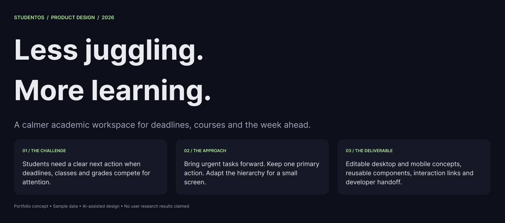
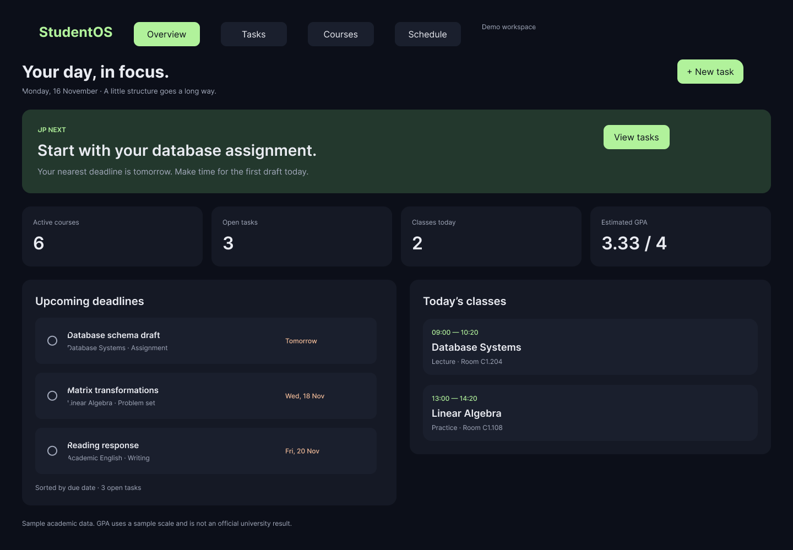
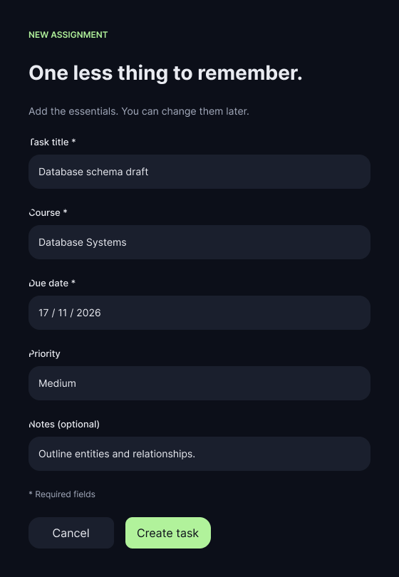
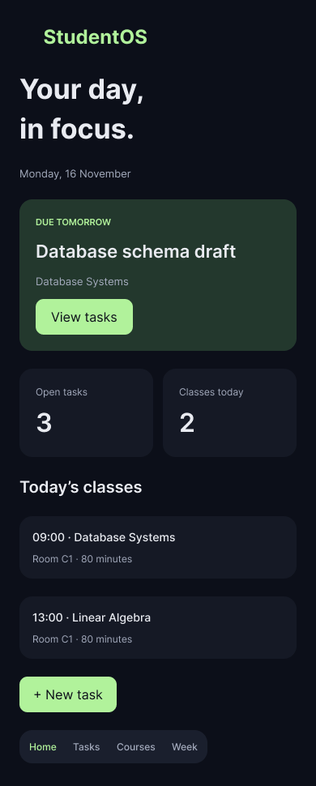
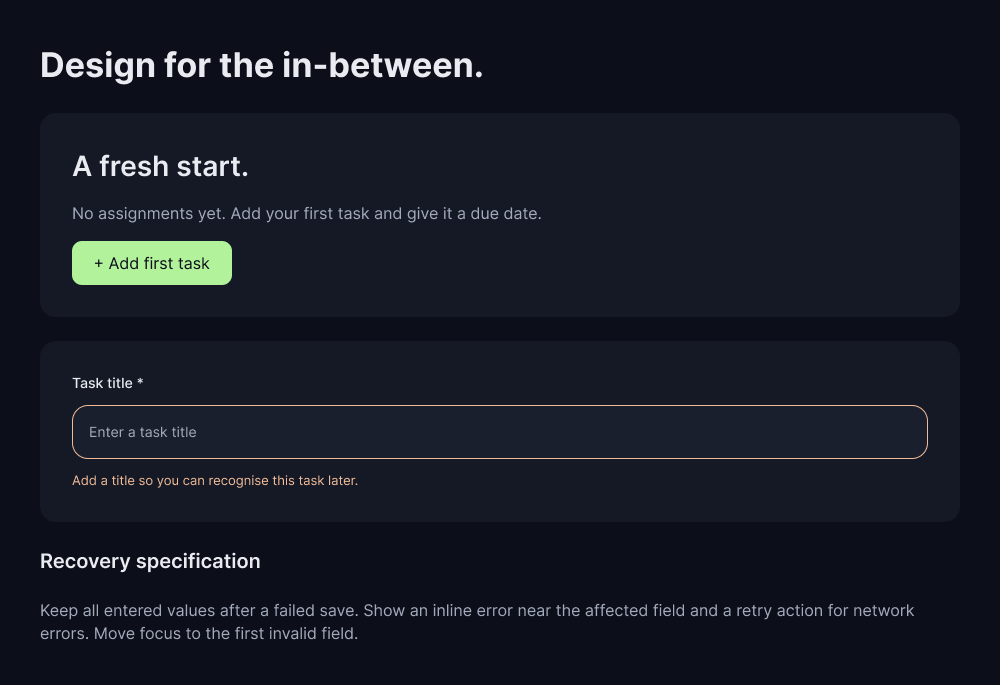
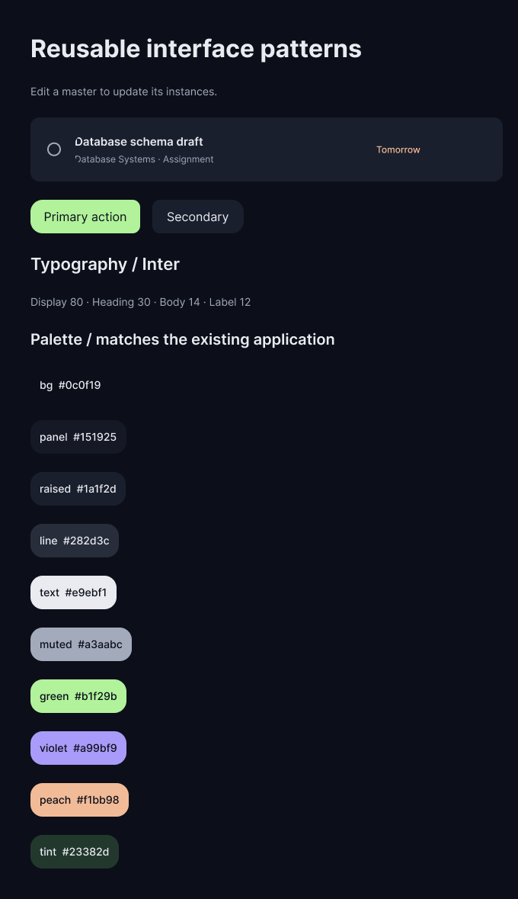

# StudentOS — Product Design Case Study

**An academic workspace that makes the next action clear.**

[Open editable Figma file](https://www.figma.com/design/sY2vgCp8rcxx8bRYpWtEuJ) · [Start desktop prototype](https://www.figma.com/proto/sY2vgCp8rcxx8bRYpWtEuJ?node-id=3-485&starting-point-node-id=3%3A485) · [Run the application](../../README.md#quick-start)

## Project context

StudentOS is a software engineering portfolio project for managing courses, assignments, schedules and estimated academic progress. This design exploration extends the existing application with a more focused overview and a documented task flow.

**Type:** self-directed portfolio concept. **Owner:** Nurkanat. **Tools:** Figma, Auto Layout, component instances, HTML/CSS and FastAPI application reference. **Process:** AI-assisted design and documentation.

This is a proposed design direction, not a claim that the running application already matches these screens. All displayed academic records are illustrative. No interviews, usability studies or business impact measurements have been conducted for this case study.

## Problem and design hypothesis

A student opening a planner should be able to answer three questions: What needs my attention first? What classes do I have today? Where can I add a new assignment?

The hypothesis is that a nearest-deadline card, a short due-date-ordered list, and one prominent creation action will make planning easier. This is an unvalidated hypothesis to test, not a measured outcome.

## Scope

| Board | Purpose |
|---|---|
| 00 — Case study cover | Context, challenge and design approach |
| 01 — Desktop overview | Next action, academic summary, deadlines and classes |
| 02 — Task manager | Upcoming assignments with course and due-date context |
| 03 — New task | Essential fields, optional notes and clear actions |
| 04 — Mobile overview | Single-column hierarchy for a 390 px viewport |
| 05 — Empty and error states | First-use guidance and actionable validation feedback |
| 06 — Reusable components | Task-row master, action instances, palette and typography |

## Desktop overview

The green focus card answers “what should I do next?” before the user reads the summary metrics. Open tasks and today's classes are kept alongside the GPA estimate so grades do not dominate the experience.

The two content columns separate assignments from the timetable. Each assignment includes both its course and a written due date. Colour supplements meaning; it does not replace a label.

## Task creation

The creation form groups title, course, due date, priority and optional notes. Required fields are marked with an asterisk. Cancel gives an explicit exit.

The linked Figma walkthrough supports **Overview → Tasks → New task → Tasks**, plus the overview’s “New task” shortcut and a mobile-to-task demonstration link. These links demonstrate navigation only: the prototype does not accept typed input, persist a task or run validation. “Create task” returns to the illustrative task list; it does not represent a successful backend submission. Courses, Schedule and filter controls are visual context rather than wired flows.

## Responsive design

At 390 px, the content becomes a single column. The next deadline stays above the summary metrics; two compact metrics replace the desktop’s four-card row. The mobile concept uses bottom navigation to keep destinations near the thumb.

The mobile-to-task link currently opens the desktop task board as a walkthrough shortcut. A complete mobile task flow is a future iteration.

## Empty states and recovery

- **No tasks:** explain what is missing and offer “Add first task”.
- **Missing title:** place a specific error beside the field; preserve other values.
- **Failed save:** preserve the draft and offer retry. This is a handoff requirement, not implemented prototype behaviour.
- **Overdue:** pair the colour with an explicit “Overdue” text label.
- **Long titles:** wrap in detailed views; avoid losing the due date.

## Reusable patterns and visual language

The editable file contains a task-row main component with text properties for title, course and due date, used by the dashboard and task list. Buttons use instances from Figma’s Simple Design System with local StudentOS visual overrides. Related content uses Auto Layout; screens are editable text, frames and instances rather than flattened screenshots.

| Token | Value | Purpose |
|---|---|---|
| Background | `#0c0f19` | Main canvas |
| Panel | `#151925` | Grouped content |
| Raised | `#1a1f2d` | Inputs and task rows |
| Border | `#282d3c` | Subtle boundaries |
| Text | `#e9ebf1` | Primary content |
| Muted | `#a3aabc` | Secondary copy, brighter than the current app |
| Accent | `#b1f29b` | Primary actions and active state |
| Violet | `#a99bf9` | Supporting course colour |
| Peach | `#f1bb98` | Due-date emphasis and feedback |
| Focus surface | `#23382d` | Next-action card |

Typography uses Inter, matching the application’s declared font stack. The UI uses 12–16 px supporting text and 20–34 px headings; the case-study cover uses an 80 px display heading. The palette reference is not a published Figma variable library.

## Developer handoff

The working application remains in `frontend/` with the FastAPI backend in `app.py`. This contribution changes design documentation only.

| Design concept | Existing implementation reference | Handoff note |
|---|---|---|
| Dashboard | `.hero`, `.stats-grid`, `.dashboard-grid` | Reconcile the proposed top navigation with existing sidebar navigation |
| Assignment row | `.task-row`, `.task-meta`, `.task-date` | Preserve course context and written due dates |
| Form | `.field`, `.modal`, `.modal-footer` | Use native labels, inputs and validation semantics |
| Mobile overview | `@media(max-width:720px)`, `.bottom-nav` | Adapt to actual viewport and safe-area insets |
| Recovery states | `.empty-state`, `.toast.error` | Add inline errors and preserve failed drafts |

See [tokens.json](tokens.json) for machine-readable palette values.

Accessibility acceptance criteria for implementation: visible keyboard focus, semantic buttons and labels, no colour-only status, at least 44 px primary action targets, error association with fields, readable layouts at 200% zoom, and screen-reader testing. These are requirements for subsequent implementation, not an accessibility certification.

## Validation performed

- Inspected editable structure: text, frames, reusable task component and button instances.
- Verified the rendered font family is Inter.
- Visually reviewed the cover, overview, task list, form, mobile, recovery and component boards; corrected text reflow and card sizing.
- Configured eight navigation reactions in Figma; no end-to-end user test was run.
- Exported six PNG previews from Figma. The task-manager board remains available in the editable file; its separate export was unavailable after the Figma Starter tool quota was reached.
- No application code was changed, so application tests were not rerun for this documentation contribution.

## What to test next

Recruit 3–5 students for a small formative study. Ask them to identify the nearest deadline, add an assignment and locate today's next class. Record completion, confusion and time on task without claiming statistical significance. Check whether the top navigation helps compared with the existing sidebar, and test narrow-screen task management before implementation.

The deliverable demonstrates design hierarchy, responsive thinking, reusable patterns and honest handoff documentation. It does not claim verified improvements in student performance or productivity.
